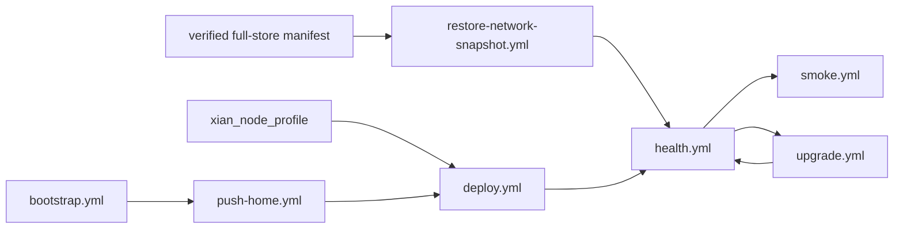

# Playbooks

## Purpose
- This folder contains the operator entrypoints for `xian-deploy`.

## Contents
- `bootstrap.yml`: prepare the host
- `push-home.yml`: upload a prepared node home
- `deploy.yml`: deploy or update the runtime
- `health.yml`: remote runtime, CometBFT configuration, BDS, and disk checks
- `upgrade.yml`: serial rollout
- `restore-network-snapshot.yml`: verify and restore a signed full-node store
- `smoke.yml`: basic post-deploy health check

## Typical Flow
1. `bootstrap.yml`
2. `push-home.yml` for a fresh home that has never signed
3. `deploy.yml`
4. `health.yml`
5. `upgrade.yml` for later image rollouts

For an initialized home, `restore-network-snapshot.yml` stops the runtime,
verifies and restores the profile's signed full-store snapshot, then starts it.
Existing node/validator keys and signing state are preserved.

